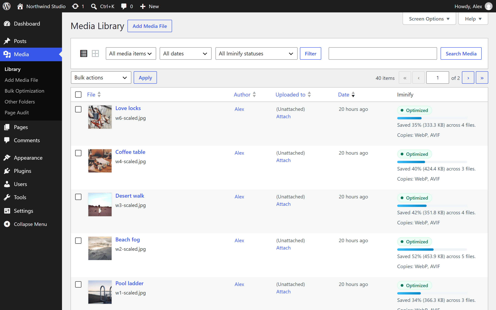

<p align="center">
  
</p>

# Iminify Image Optimizer

A WordPress plugin that sends the images you upload to [Iminify](https://www.iminify.com), which compresses them and every size WordPress keeps of them, makes WebP and AVIF copies, and sends the smaller files back under the same names. Visitors get the copies through picture tags, and a browser that reads neither format gets the original.

The plugin is in review for the WordPress plugin directory. Once it's listed, you'll install it from **Plugins > Add New** by searching for Iminify; until then, the [plugin's page](https://www.iminify.com/wordpress-plugin) shows what it does. It needs WordPress 6.9 or later and PHP 7.4 or later.



## What sets it apart

- **One upload counts as one image.** Iminify makes the sizes from your original instead of compressing the copies WordPress already shrank, and counts the set once. A photo WordPress keeps in six sizes comes back as 18 files with WebP and AVIF on, and it's still one image on your plan.
- **Quality is picked per image.** Each image gets the lowest quality that still looks as good as your level promises, measured on that image, so a detailed photo and a flat graphic don't share one quality number.
- **A size limit in KB.** Set one and the main image is fitted under it. The quality goes down first, and the dimensions only when that isn't enough.
- **Page Audit, matched to your library.** Iminify opens one of your pages as a visitor would and lists each image that slows it down beside its media library item, with the fix next to it.
- **AI alt text where there's none**, in the language you pick. Alt text you wrote is never replaced.
- **Originals you can get back.** Backups are on from the first upload, so you can restore one image or the whole library on any plan, even with the site disconnected.

## Getting started

1. Install the plugin and activate it.
2. Open **Settings > Iminify** and press **Connect**. iminify.com opens in a new tab, where you sign in or create a free account and approve the site.
3. New uploads are optimized from then on. For the images already in your library, open **Media > Bulk Optimization** and press **Optimize the library**, or run `wp iminify optimize --all`.

An agency can paste a site key on the settings page instead, or set it as `IMINIFY_API_KEY` in `wp-config.php`.

If you're switching from Imagify, ShortPixel, EWWW, Smush, TinyPNG, Optimole or another optimizer, the images it compressed show as optimized and cost nothing, the originals it kept can still be restored, and the settings page offers to carry its settings over. The [guide's switching section](https://www.iminify.com/docs/wordpress#switching-from-another-optimizer) lists every plugin it reads.

## Plans

The plugin is free, and so is an Iminify account; a new account starts with a free trial of Pro. Every plan gets WebP, AVIF, backups, page audits and AI alt text, and you can connect as many sites as you like. The daily limits are on the [pricing page](https://www.iminify.com/pricing).

## Documentation

- [The WordPress guide](https://www.iminify.com/docs/wordpress) covers connecting a site or a multisite network, each setting, the page audit, serving WebP and AVIF, WP-CLI and the hooks.
- [readme.txt](readme.txt) is the plugin's description for WordPress users, with its FAQ and the External services section: what the plugin sends to Iminify, and when.

## Development

Requirements: PHP 7.4 or later, Composer, Node.js 22.13 or later, and Docker for wp-env.

```bash
composer install
npm install
npm run env start                 # the development site at http://localhost:8888
npm run env:test start            # the test site at http://localhost:8889

composer lint                     # coding standards and PHP 7.4 compatibility
composer types                    # PHPStan
composer test                     # unit tests
npm run test:integration          # integration tests on WordPress's test library
php bin/build.php                 # the plugin as it ships, in build/
```

## License

GPLv2 or later. See [license.txt](license.txt).
